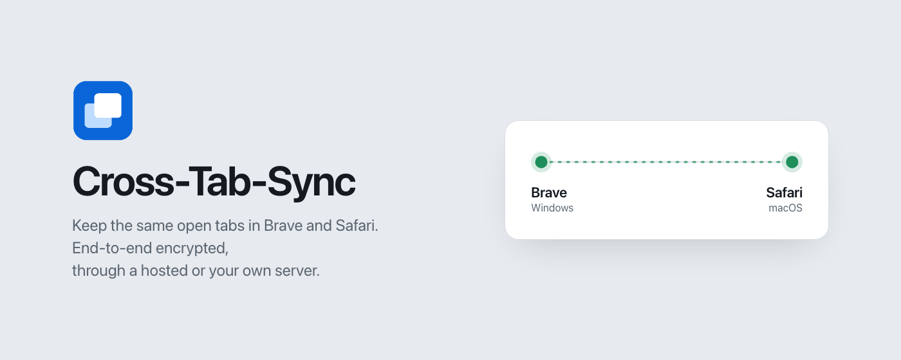
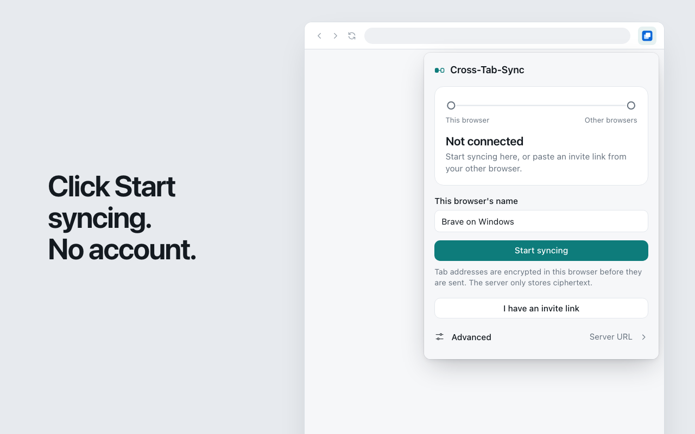
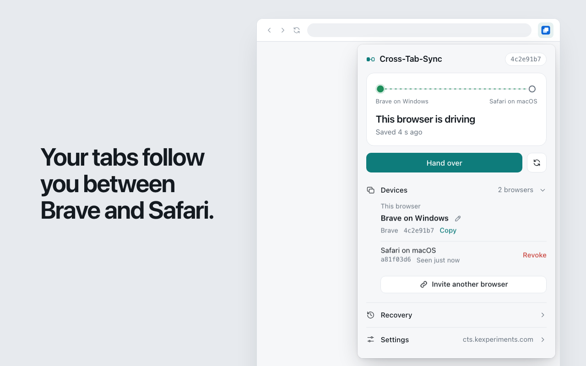
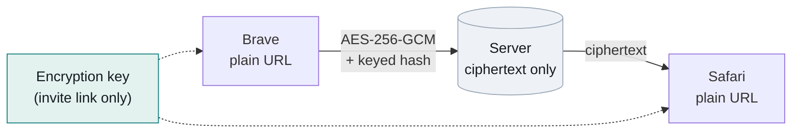
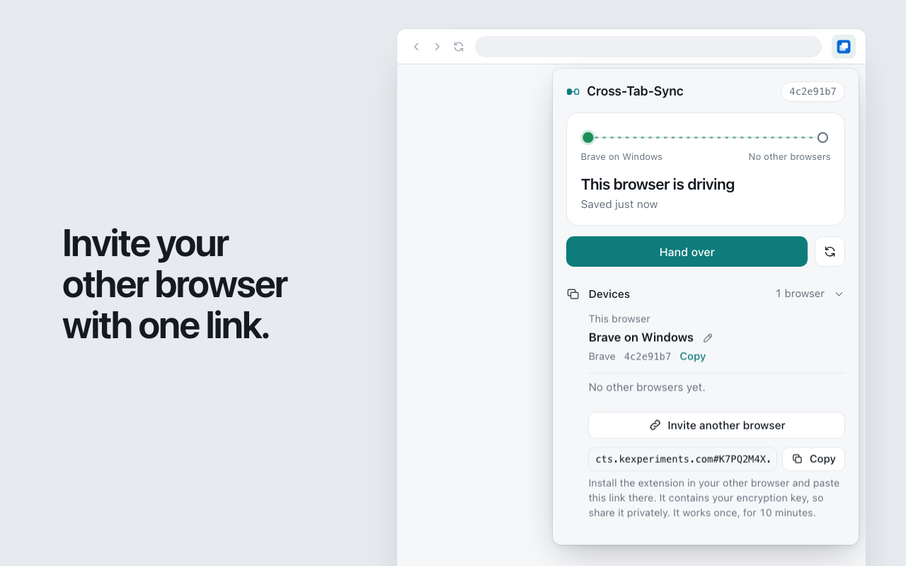
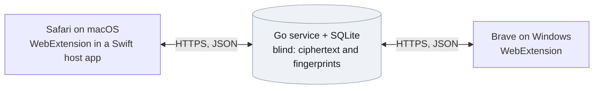

<div align="center">


# Cross-Tab-Sync

**Your open tabs follow you between Brave and Safari.**<br>
End-to-end encrypted. No account. Hosted server included, or run your own.

[](https://github.com/KaanEmec/cross-tab-sync/actions/workflows/ci.yml)
[](https://github.com/KaanEmec/cross-tab-sync/releases/latest)
[](LICENSE)
[](https://chromewebstore.google.com/detail/cross-tab-sync/doimphmglhmgenljfmaopbphbhmpcfdk)
[](https://github.com/KaanEmec/cross-tab-sync/releases/latest)

[Install](#install) · [Privacy](#privacy-the-server-cannot-read-your-tabs) · [How it works](#how-it-works) · [Your own server](#run-your-own-server) · [Docs](#documentation)



</div>

## What it does

You read on your Mac in Safari, sit down at your Windows PC, open Brave, and the same tabs are there. Switch back, and Safari catches up. One browser *drives* at a time: the one you are using. The other follows in the background without stealing your focus.

- **Opens, navigations and closes propagate.** Open a tab in one browser, it appears in the other. Navigate it, the other one follows. Close it, the other copy closes.
- **Closing a window never deletes anything.** Only an individual tab close during use is treated as a closure. Quitting, crashing or a lost laptop leaves your shared tabs intact.
- **Offline work merges.** Changes made without a connection are journaled and merged on reconnect, without duplicates and without losing either side's navigation.
- **Recovery snapshots.** Every destructive change is preceded by a snapshot you can restore from the popup.

<div align="center">
<table>
<tr>
<td width="50%"></td>
<td width="50%"></td>
</tr>
<tr>
<td align="center"><sub>One click to start. No account.</sub></td>
<td align="center"><sub>The relay shows which browser is driving.</sub></td>
</tr>
</table>
</div>

## Privacy: the server cannot read your tabs

Tab addresses are encrypted **inside your browser** before anything is sent. The server, hosted or your own, stores ciphertext and a keyed fingerprint it uses only to merge duplicates. The key is generated by your first browser and travels only inside the invite link you paste into your other browser. It is never sent to the server.



| The server sees | The server never sees |
| --- | --- |
| How many tabs you have and when they change | Any tab address, title or page content |
| Which of your devices made a change | Cookies, history, logins, form data |
| Device names you chose ("Brave on Windows") | Private-window tabs |
| Pinned state and tab order | IP addresses on disk (rate-limit memory only, 10 minutes) |
| Whether two tabs point at the same address | Your encryption key |

- **AES-256-GCM** for each address, bound to its fingerprint, with random nonces and length padding.
- **HMAC-SHA256** fingerprint so duplicates still merge without decryption.
- **Blind server:** it validates length and alphabet and stores the bytes. It runs no cryptography and never decodes a ciphertext.
- **Key check:** a browser with a different key is refused before it can send or apply anything.
- **No analytics, no tracking, no third parties.** Disconnecting the last browser deletes the session immediately.

Full policy: [docs/PRIVACY.md](docs/PRIVACY.md). Threat model and algorithms: [docs/ARCHITECTURE.md](docs/ARCHITECTURE.md#threat-model), [docs/PROTOCOL.md](docs/PROTOCOL.md#encryption).

## Install

The extension uses the hosted server `https://cts.kexperiments.com` by default. It is free, holds only ciphertext, and runs this repository's code unchanged. Prefer your own server? See [Run your own server](#run-your-own-server); the steps below stay the same.

### 1. Brave (or Chrome) on Windows

1. Add **Cross-Tab-Sync** from the [Chrome Web Store](https://chromewebstore.google.com/detail/cross-tab-sync/doimphmglhmgenljfmaopbphbhmpcfdk).
2. Pin it from the puzzle icon, click it, check the device name and click **Start syncing**. Allow access to the sync server when asked.
3. The popup shows an **invite link**. Copy it and get it to your other computer privately, for example in a note to yourself. It works once, for 10 minutes.

### 2. Safari on macOS (Safari 18.4+, macOS 13+)

1. Download `Cross-Tab-Sync-<version>.dmg` from the [latest release](https://github.com/KaanEmec/cross-tab-sync/releases/latest) and drag the app to **Applications**. Open it once, then quit it.
2. Safari › **Settings › Extensions**: tick **Cross-Tab-Sync**, then **Edit Websites** → **All Websites**. Without this Safari hides tab addresses from extensions.
3. Click the toolbar icon, choose **I have an invite link**, paste the link, confirm.

That is all. The browser you use drives; the other one catches up when you switch to it. Doing it the other way round (Safari first, Brave second) works the same.

<div align="center">

<br><sub>The invite link carries your key. Paste it into the extension, never into the address bar.</sub>
</div>

### Without the store

Download `cross-tab-sync-brave-<version>.zip` from the [latest release](https://github.com/KaanEmec/cross-tab-sync/releases/latest), extract it, open `brave://extensions`, enable **Developer mode**, **Load unpacked**, pick the folder. This copy does not update itself.

Step-by-step with troubleshooting: [docs/INSTALL.md](docs/INSTALL.md).

## Run your own server

A single small Go binary with a SQLite file. It serves any number of independent, encrypted sessions, so one instance can hold your whole household. Set `CTS_MAX_SESSIONS=1` on a personal server so nobody else can start a session on it.

In each extension open **Advanced**, enter your server address, then **Start syncing** or paste the invite as above.

### Docker Compose (any VPS)

Needs Docker, ports 80 and 443 open, and a domain pointing at the server.

```bash
git clone https://github.com/KaanEmec/cross-tab-sync && cd cross-tab-sync/deploy
printf 'CTS_DOMAIN=tabs.example.com\nCTS_MAX_SESSIONS=1\n' > .env
docker compose pull cts && docker compose up -d
```

Caddy obtains the HTTPS certificate on first start; the service port is never published. Check `https://tabs.example.com/healthz` answers `{"status":"ok"}`.

### Coolify

New resource → **Public repository** `https://github.com/KaanEmec/cross-tab-sync`, branch `main`, build pack **Dockerfile**, base directory `/server`, port `8080`, a persistent volume at `/data`, your domain, health check off. Optional: `CTS_MAX_SESSIONS=1`. Deploy.

### Binaries and image

Every release ships `cross-tab-sync_linux_amd64`, `cross-tab-sync_linux_arm64`, `cross-tab-sync_darwin_arm64` and the image `ghcr.io/kaanemec/cross-tab-sync`. Backups are one directory; upgrades run migrations automatically. Details, settings and backup commands: [docs/INSTALL.md](docs/INSTALL.md#3-your-own-server-optional), [server/README.md](server/README.md).

## How it works

| | |
| --- | --- |
| **One driver** | Exactly one browser publishes at a time. Recent activity in the other browser (a click, a focus) takes over within about a second. A browser that merely stays open never takes over. |
| **Followers catch up** | The following browser pulls changes every five minutes and immediately when you switch to it, adding missing tabs in the background and reusing tabs that are already open. |
| **Explicit closes only** | A closure is recorded only when you close an individual tab. Window close, quit and crash restore unmap tabs locally and delete nothing. |
| **Offline merge** | Changes are journaled with their base revision and merged with causal checks: a close that races a navigation forks instead of overwriting, so both pages survive. |
| **Hand over, Continue here** | Manual overrides for the rare case you want to pass or take control explicitly. |
| **Recovery** | Snapshots before every destructive change; restore reopens the addresses in the background. |

Scope: ordinary `http` and `https` tabs, pinned state and order where the browser allows. Not synced: private windows, browser pages, tab groups, cookies, history, logins, unsaved forms.

## Architecture



- **Extension**: one TypeScript core shared by both browsers, browser-free and unit tested; a thin adapter over the `chrome.*` API; encryption at the HTTP boundary so the sync logic never sees ciphertext.
- **Safari**: a minimal Swift app that only hosts the extension (Developer ID signed, notarized).
- **Server**: Go standard library, pure-Go SQLite, an append-only operation log with revisions and single-owner generations, recovery snapshots, 30-day history retention.
- **Protocol**: versioned contract in [docs/PROTOCOL.md](docs/PROTOCOL.md); clients and server are tested against it, including an integration suite that boots the real server.

## Development

```bash
cd server    && go test -race ./... && golangci-lint run
cd extension && pnpm install && pnpm test && pnpm typecheck && pnpm build && pnpm test:integration
```

`extension/dist/brave` loads unpacked in Brave or Chrome; `safari/` holds the Xcode project (see [safari/README.md](safari/README.md)). Live-test notes for both browsers on one Mac: [docs/VALIDATION.md](docs/VALIDATION.md).

## Documentation

| | |
| --- | --- |
| [docs/INSTALL.md](docs/INSTALL.md) | Installation, your own server, backups, upgrades, troubleshooting |
| [docs/PRIVACY.md](docs/PRIVACY.md) | Privacy policy |
| [docs/ARCHITECTURE.md](docs/ARCHITECTURE.md) | Design, decisions, threat model |
| [docs/PROTOCOL.md](docs/PROTOCOL.md) | Wire contract and client behavior, including the encryption scheme |
| [docs/COMPATIBILITY.md](docs/COMPATIBILITY.md) | Safari and Chromium capabilities and verified behavior |
| [ROADMAP.md](ROADMAP.md) | Milestones and job files under `versions/` |

## Contributing

Issues and pull requests are welcome at [github.com/KaanEmec/cross-tab-sync](https://github.com/KaanEmec/cross-tab-sync/issues). Behavior changes go through `docs/PROTOCOL.md` first, and tests accompany every change to the core or the server.

## License

[MIT](LICENSE) © 2026 Kaan Emeç
